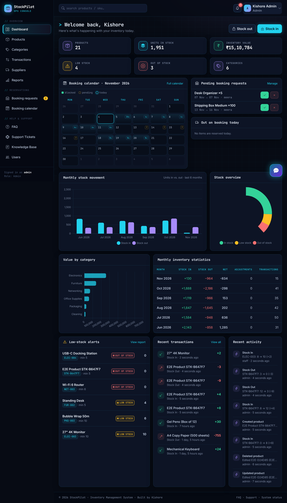
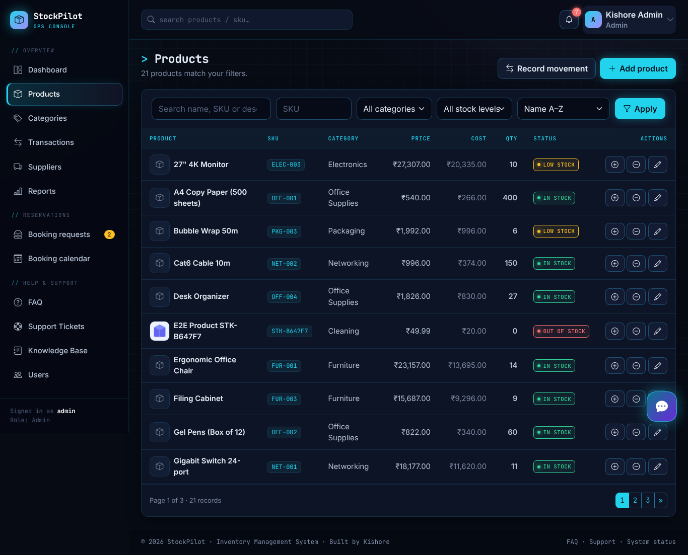
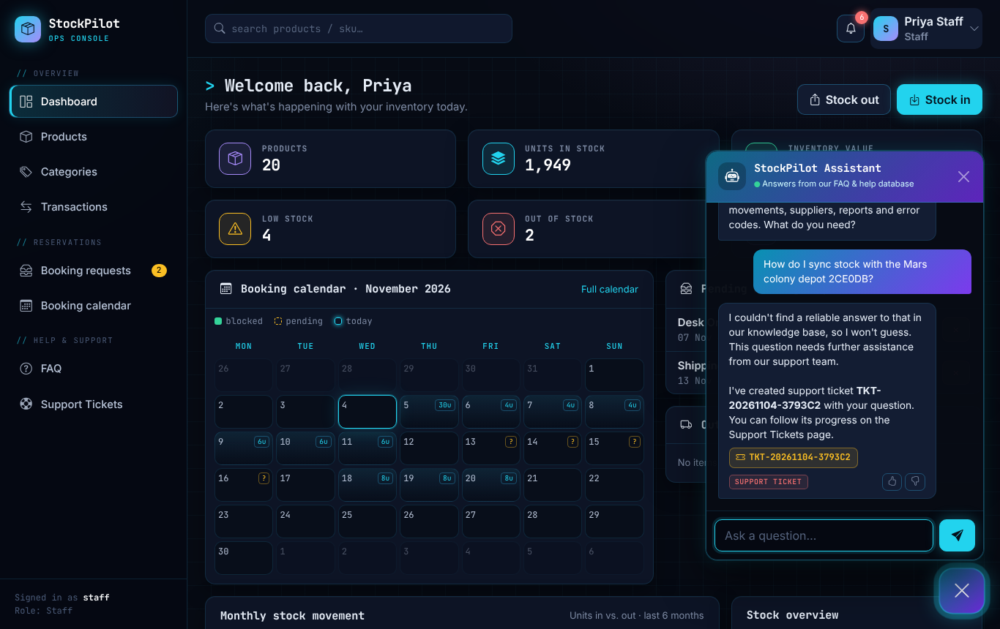
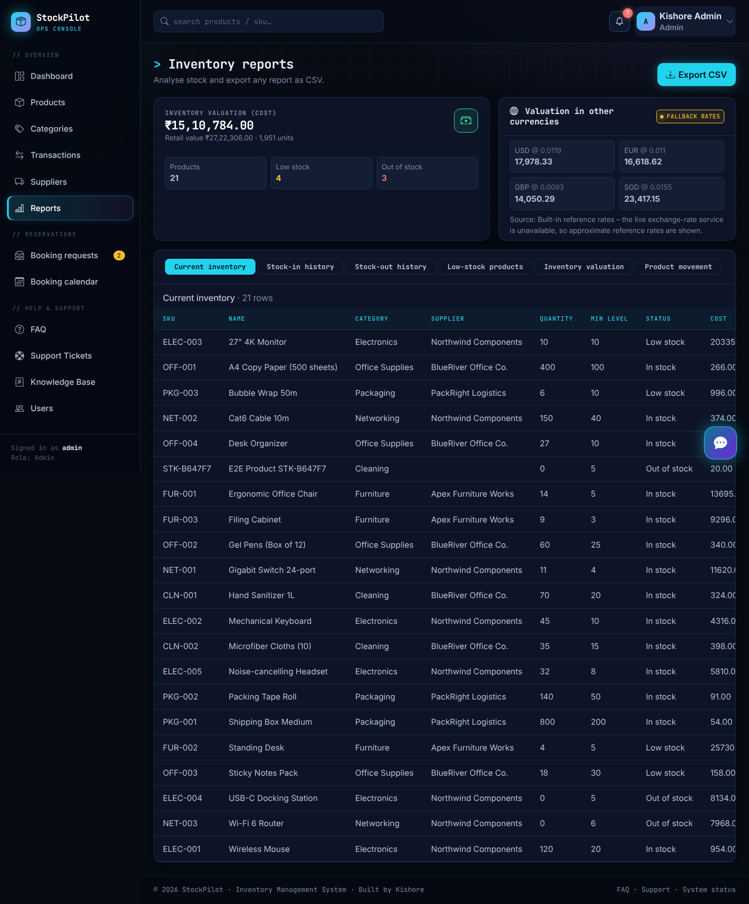
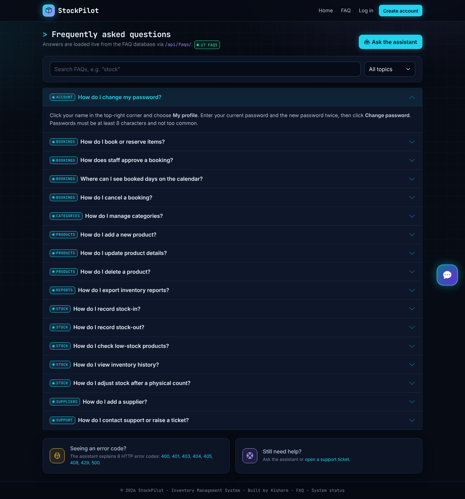
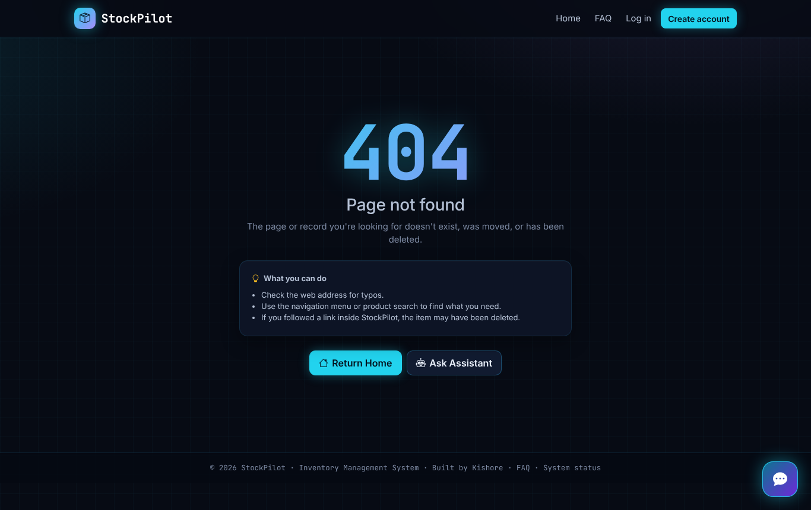
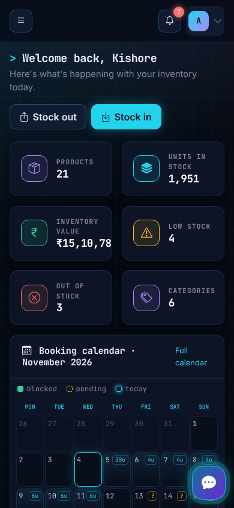
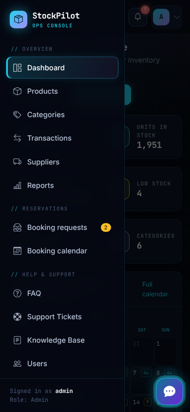
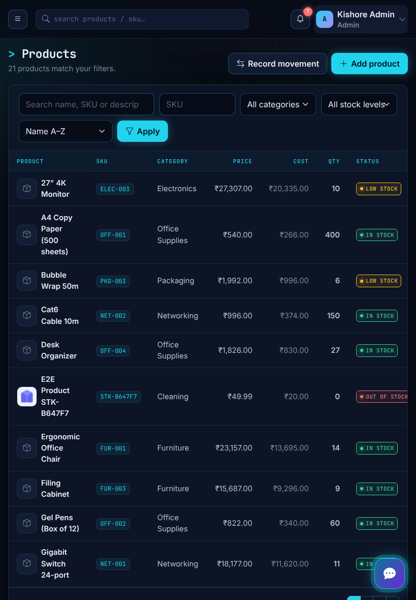

# StockPilot – Inventory Management System

A production-ready inventory management and **item reservation** web application (prices in **Indian Rupees ₹**) built with **Django 5**, **Django REST Framework**, **PostgreSQL**, **MongoDB** and **Bootstrap 5**, featuring a database-backed AI help assistant available on every page.

Developer: **Kishore**

| | |
|---|---|
| **Live HTTPS address** | https://gather-co.onrender.com |
| **GitHub repository** | https://github.com/kishorekix28-dot/Gather-Co. |

---

## 1. Overview

StockPilot lets a business track products, stock movements, suppliers and reports in one secure workspace. Administrators manage the catalogue, suppliers, users, FAQs and error codes; staff record stock-in/stock-out and raise support tickets. A floating assistant answers questions from FAQs, error codes and help articles stored in SQL, and opens a support ticket instead of guessing when it cannot answer. Conversations and feedback are stored in MongoDB.

## 2. Features

**Inventory**
- Dashboard: total products, units, inventory value, low/out-of-stock counts, categories, recent transactions, recent activity, stock-status doughnut, monthly stock-in/out chart, value-by-category chart and a monthly statistics table.
- Products: full CRUD, image upload, category, supplier, unique SKU (case-insensitive, validated), price, purchase cost, opening stock, minimum stock level, description.
- Stock: stock-in, stock-out, admin adjustments, atomic updates with row locking, **negative stock prevented** (DB check constraint + service validation), append-only ledger with before/after quantities, low-stock and out-of-stock alerts (bell menu + notifications).
- Categories (CRUD, search, category-wise products) and suppliers (CRUD, contact details, purchase history and spend).
- Search by name/SKU/description, SKU search, category & stock filters, sort by price/quantity, pagination.
- Reports: current inventory, stock-in, stock-out, low stock, valuation, product movement – all exportable to CSV (formula-injection safe).

**Bookings & reservations**
- Three roles: **Admin**, **Staff** and **Customer**. Public sign-up creates a Customer account.
- Customer dashboard: pick a date range, see live availability per item (units free on every day of the range), book items with a note, track status, cancel.
- Only **approved** bookings block units. Approval re-checks availability inside a database transaction with the product row locked, so the same units can never be double-booked on any day.
- Staff: booking-request queue (approve / reject with a message), a month **booking calendar** showing blocked items and units per day (pending requests dashed), and a calendar + pending list on the staff dashboard.

**Accounts & security**
- Registration, login, logout (POST only), PBKDF2 password hashing, session management, password change.
- Roles: **ADMIN** (full access, users, suppliers, reports, knowledge base, all tickets), **STAFF** (inventory, stock-in/out, booking approvals and calendar) and **CUSTOMER** (bookings, own tickets, assistant). Customers cannot open inventory pages or APIs.
- CSRF on all forms and the chat API, HttpOnly/secure cookies, HSTS, SSL redirect, secrets only in environment variables, API throttling and chat rate limiting.

**Assistant & support**
- Floating chat widget (bottom-right) on every page, including error pages: open/close, history for the session, loading indicator, error messages (400/403/429/500/network/timeout), thumbs-up/down feedback.
- Retrieval-first engine (IDF-weighted keyword matching with synonyms) over **FAQ**, **ErrorCode** and **HelpArticle** SQL tables. Optional LLM (`AI_API_KEY`) only rephrases retrieved text – it never answers on its own.
- When confidence is low: tells the user, creates a support ticket (`TKT-YYYYMMDD-XXXXXX`) and shows the ID. Repeated identical questions in the same conversation reuse the same ticket (DB unique constraint).
- Support tickets: CRUD for users (edit/cancel while open), full management for admins (search, status, priority, response, close). Statuses: Open, In Progress, Waiting for Response, Resolved, Closed.
- MongoDB collections `conversations`, `messages` (with response source: `faq`, `error_database`, `help_docs`, `ai_fallback`) and `feedback`; graceful degradation when MongoDB is down.

**Operations**
- Custom 400/403/404/500 pages with correct status codes, **Return Home** and **Ask Assistant** buttons.
- Request logging middleware (timestamp, method, path without query string, status, duration) to console + rotating `logs/requests.log`; no bodies, cookies or credentials.
- `GET /health/` – checks SQL and MongoDB separately; `healthy`, `degraded` (MongoDB down, HTTP 200) or `unhealthy` (SQL down, HTTP 503).
- Third-party **Frankfurter (ECB) currency API** converts the ₹ inventory valuation to USD/EUR/GBP/SGD on the Reports page with a 5 s timeout, error/invalid-payload handling, logging, caching and fallback reference rates.

## 3. Technology stack

| Layer | Technology |
|---|---|
| Backend | Python 3.12, Django 5.1, Django REST Framework 3.15 |
| Frontend | HTML5, CSS3 (dark "ops console" theme), vanilla JavaScript, Bootstrap 5.3, Bootstrap Icons, Chart.js 4, Inter + JetBrains Mono (all vendored, no CDN) |
| SQL database | PostgreSQL 16 (production) / SQLite (local fallback) |
| Chat & feedback | MongoDB (pymongo) |
| Server | Gunicorn + WhiteNoise |
| Testing | Django test runner, Playwright (pytest-playwright), pytest-html |
| Deployment | Render (Blueprint `render.yaml`), MongoDB Atlas |

## 4. Architecture

```
Browser ──HTTPS──► Gunicorn ─► Django
                                │  middleware: RequestLogging → Security → WhiteNoise → Session → CSRF → Auth
                                ├─ accounts   (auth, roles, users)
                                ├─ inventory  (dashboard, products, categories, stock ledger, reports)
                                ├─ suppliers  (suppliers, purchase history)
                                ├─ support    (tickets)
                                ├─ assistant  (FAQ / ErrorCode / HelpArticle, engine, chat API, MongoDB store, optional LLM)
                                ├─ api        (DRF endpoints)
                                └─ core       (health, error handlers, logging, currency API)
                                   │                     │                       │
                               PostgreSQL            MongoDB              Frankfurter API
                          (all business data)  (chat + feedback only)   (5 s timeout + fallback)
```

Stock changes go exclusively through `inventory.services.record_transaction`, which locks the product row (`select_for_update`), validates the movement and writes the ledger entry in one transaction.

## 5. Database structure

**SQL (PostgreSQL)**

| Model | Key fields |
|---|---|
| `accounts.Profile` | user (1:1), role (ADMIN/STAFF), phone |
| `inventory.Category` | name (unique), description |
| `inventory.Product` | name, sku (unique, upper-case), category, supplier, price, cost, quantity (≥ 0 constraint), min_stock_level, image, description |
| `inventory.StockTransaction` | product, type (IN/OUT/ADJ), quantity, quantity_change, before/after, unit_cost, supplier, reference, note, user, created_at |
| `inventory.ActivityLog` | user, action, description, created_at |
| `bookings.Booking` | booking_id, customer, product, quantity, start_date, end_date, status (pending/approved/rejected/cancelled), notes, reviewed_by/at |
| `suppliers.Supplier` | name, contact_person, email, phone, address, website, notes, is_active |
| `support.Ticket` | ticket_id, user, subject, description, status, priority, source, admin_response, conversation_id, question_hash, created/updated |
| `assistant.FAQ` | question, answer, category, keywords, is_active, created/updated (13 seeded) |
| `assistant.ErrorCode` | code, title, description, possible_causes, recommended_solution, created (400, 401, 403, 404, 405, 408, 429, 500 seeded) |
| `assistant.HelpArticle` | title, keywords, content (application help docs) |

FAQs, error codes and help articles are seeded by data migration `assistant/0002_seed_knowledge_base`, so every environment has them after `migrate`.

**MongoDB**

| Collection | Document |
|---|---|
| `conversations` | conversation_id, user_id or session_id, created_at, updated_at |
| `messages` | conversation_id, user_message, assistant_response, source, matched, ticket_id, timestamp |
| `feedback` | conversation_id, message_id, rating (1/-1), feedback_text, timestamp |

## 6. Installation

```bash
git clone https://github.com/kishorekix28-dot/Gather-Co..git inventory-management
cd inventory-management
python -m venv .venv
.venv\Scripts\activate          # Windows  (source .venv/bin/activate on macOS/Linux)
pip install -r requirements.txt
copy .env.example .env          # cp on macOS/Linux, then edit the values
```

## 7. Environment variables

| Variable | Purpose |
|---|---|
| `SECRET_KEY` | Django secret (required when `DEBUG=False`) |
| `DEBUG` | `True` for local development only |
| `ALLOWED_HOSTS`, `CSRF_TRUSTED_ORIGINS` | Comma-separated hosts / origins |
| `DATABASE_URL` | PostgreSQL URL; empty → SQLite |
| `MONGODB_URI`, `MONGODB_DB_NAME` | MongoDB connection for chats & feedback |
| `AI_API_KEY`, `AI_PROVIDER`, `AI_API_BASE`, `AI_MODEL` | Optional LLM rephrasing |
| `CURRENCY_API_URL`, `CURRENCY_API_TIMEOUT`, `BASE_CURRENCY` | Currency API |
| `DJANGO_ADMIN_USERNAME/EMAIL/PASSWORD` | Admin created by `ensure_admin` on deploy |
| `DEMO_ADMIN_PASSWORD`, `DEMO_STAFF_PASSWORD` | Passwords for `seed_demo` users |
| `USE_HTTPS` | Secure cookies / SSL redirect / HSTS (default on when `DEBUG=False`) |

`.env` is git-ignored; only `.env.example` (no values) is committed.

## 8. Running locally

```bash
python manage.py migrate
python manage.py seed_demo            # demo data; needs DEMO_ADMIN_PASSWORD / DEMO_STAFF_PASSWORD
python manage.py runserver
```
Open http://127.0.0.1:8000 and log in as `admin` or `staff` with the passwords you set.

## 9. API endpoints

| Method | Endpoint | Access |
|---|---|---|
| GET | `/api/faqs/` · `/api/faqs/<id>/` · `/api/faqs/search/?q=stock` | Public read, admin write |
| GET | `/api/errors/` · `/api/errors/<code>/` · `/api/errors/search/?q=unauthorized` | Public read, admin write |
| GET | `/api/products/?q=&category=&stock=&sort=` · `/api/products/<id>/` | Authenticated |
| GET | `/api/inventory/summary/` | Authenticated |
| GET/POST | `/api/tickets/` | Authenticated (own tickets; admins see all) |
| POST | `/assistant/chat/` · `/assistant/feedback/` | CSRF-protected JSON |
| GET | `/assistant/history/` | Current session |
| GET | `/health/` | Public |
| GET/POST | `/bookings/` · `/bookings/new/` · `/bookings/mine/` | Customers |
| GET/POST | `/bookings/manage/` · `/bookings/calendar/?month=YYYY-MM` · `/bookings/<id>/approve/` · `/bookings/<id>/reject/` | Staff |

## 10. Testing

```bash
# Django tests (90) – use PostgreSQL + MongoDB for full coverage
set DATABASE_URL=postgresql://...   &  set MONGODB_URI=mongodb://...
python manage.py test tests

# All pre-commit checks (check, migrations, tests, check --deploy, collectstatic, secret scan)
bash scripts/run_checks.sh

# Playwright end-to-end (32 tests) against a running server
pip install -r requirements-dev.txt && playwright install chromium
set E2E_BASE_URL=http://127.0.0.1:8000
set E2E_ADMIN_PASSWORD=...  &  set E2E_STAFF_PASSWORD=...
set E2E_MONGODB_URI=mongodb://127.0.0.1:27017  &  set E2E_MONGODB_DB=inventory_assistant
pytest --html=docs/test-reports/playwright-report.html --self-contained-html
```

Latest results (PostgreSQL 16 + MongoDB 7, production settings with Gunicorn): **90/90 Django tests passed**, **32/32 Playwright tests passed** (including the full customer-books → staff-approves → calendar-blocks flow). Evidence is in [`docs/test-reports/`](docs/test-reports/).

## 11. Deployment (Render)

1. Create a free **MongoDB Atlas** cluster and copy its connection string.
2. On Render choose **New → Blueprint** and select this repository – `render.yaml` creates the PostgreSQL database and the web service.
3. Fill the `sync: false` variables: `MONGODB_URI`, `DJANGO_ADMIN_USERNAME`, `DJANGO_ADMIN_EMAIL`, `DJANGO_ADMIN_PASSWORD` (and optionally `AI_API_KEY`).
4. `build.sh` installs requirements, runs `collectstatic`, `migrate` and `ensure_admin`; Gunicorn serves the app. Render provides HTTPS; Django enforces SSL redirect, HSTS and secure cookies, and `/health/` is the health-check path.

## 12. Screenshots

| Dashboard | Products | Assistant ticket |
|---|---|---|
|  |  |  |
| **Reports + currency API** | **FAQ from API** | **Custom 404** |
|  |  |  |
| **Mobile dashboard** | **Mobile menu** | **Tablet products** |
|  |  |  |

## 13. Known limitations

- Uploaded product images are stored on the local filesystem; Render's free disk is ephemeral, so images should move to object storage (S3/Cloudinary) for long-term production use.
- The assistant uses keyword retrieval; very differently phrased questions may become tickets rather than answers (by design – it never invents answers).
- Rate limiting uses the in-process cache; multiple instances would need Redis.
- Currency rates come from the free Frankfurter API; when it is unreachable, approximate reference rates are shown and labelled as such.

## 14. Deployment status

Deployed on Render (free web service + free PostgreSQL) at **https://gather-co.onrender.com**. Verified 4 Nov 2026: `/health/` reports SQL connected (PostgreSQL); 13 FAQs and 8 error codes served by the API; FAQ page renders 13 items; chat widget answers FAQs and error codes and creates tickets; unknown URLs return 404. MongoDB is not configured on the live site yet (health shows `degraded`) – set `MONGODB_URI` in Render to enable chat history and feedback storage. The free instance sleeps when idle, so the first request can take ~50 s.

## 15. Improvements (future work)

- Barcode scanning with the device camera for stock-in/stock-out.
- QR-code labels for shelf and bin-level tracking.
- Predictive stock forecasting from the monthly movement history.
- Automated purchase recommendations / draft purchase orders when stock hits the minimum level.
- Advanced analytics: ABC analysis, turnover ratio, dead-stock detection.
- Multiple warehouse / location management with stock transfers.
- Email/Slack notifications for low stock and ticket updates.
- Semantic (embedding) search for the assistant and multilingual support.
